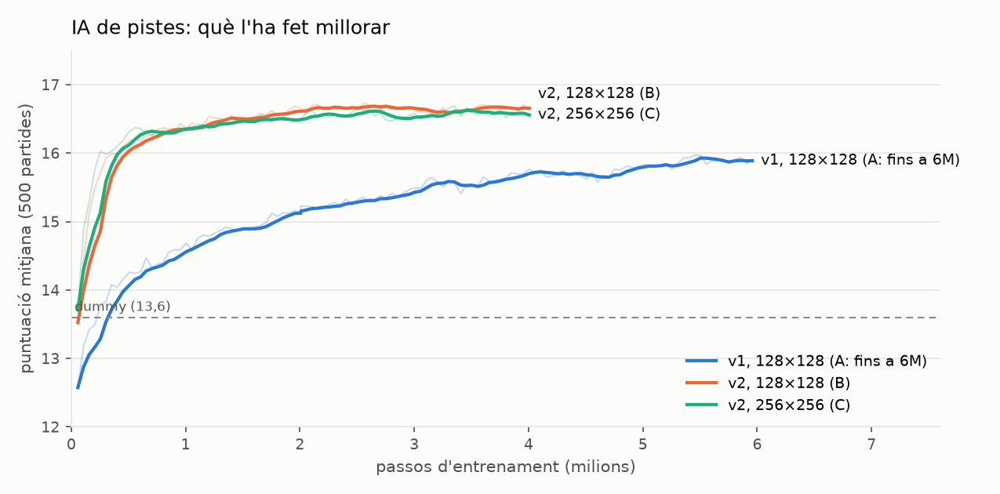
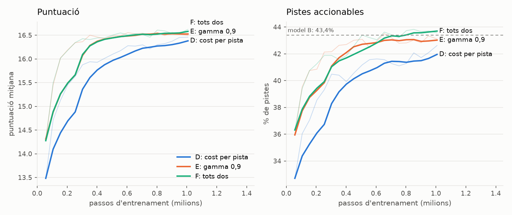
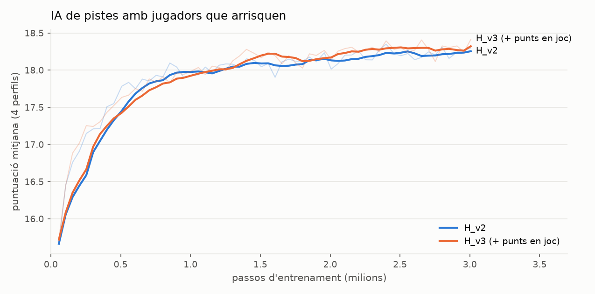
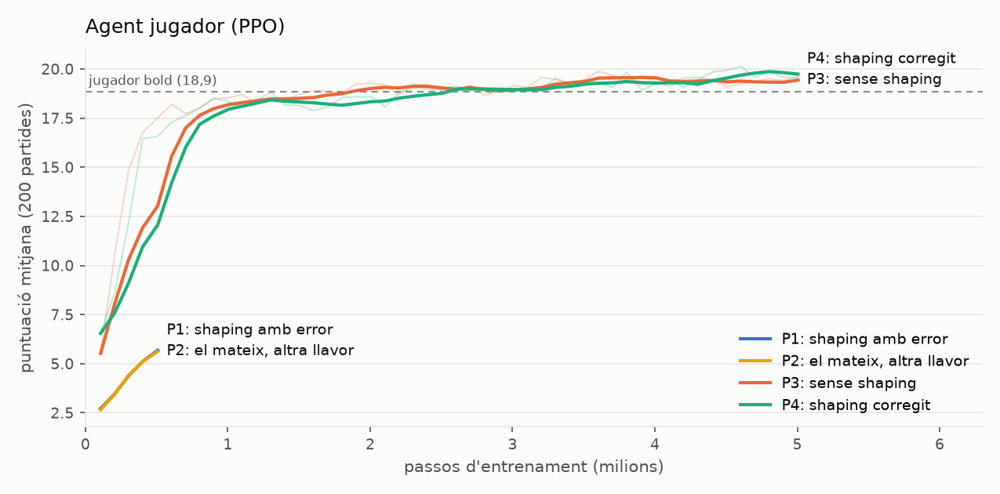
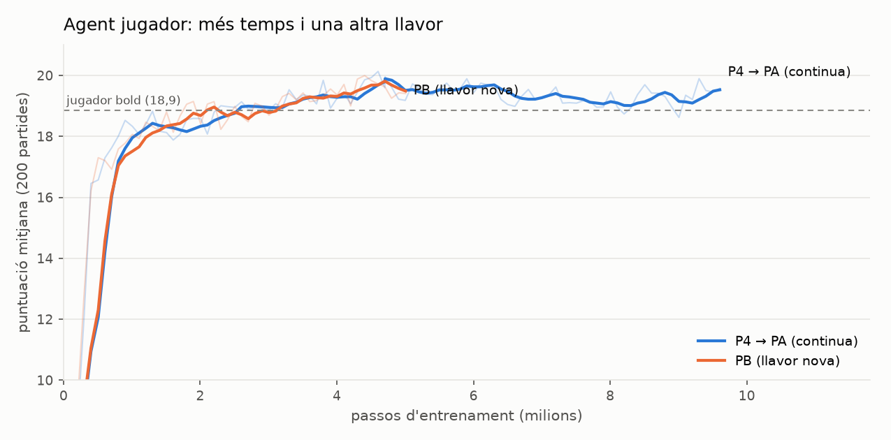
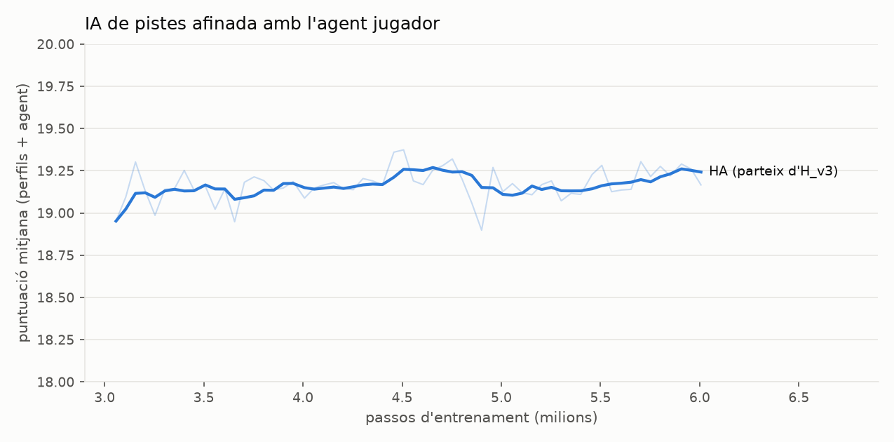
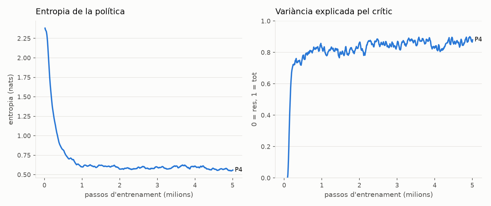

# La IA del Hanabi: com l'hem entrenada

Aquest document explica, de principi a fi, com s'ha construït la IA del joc amb
*reinforcement learning* (RL): què és cada peça, quins experiments s'han fet,
què ha funcionat, què no i per què. Les gràfiques surten dels registres de
TensorBoard (`rl/runs/`) i es regeneren amb `cd rl && uv run python plots.py`.

## Resum

| | puntuació mitjana (sobre 25) |
|---|---|
| Pistes a l'atzar | 8,3 |
| Bot original de la consola (*dummy*) | 13,6 |
| IA de pistes, primer entrenament | 15,1 |
| IA de pistes, amb "efecte de cada pista" (v2) | 16,6 |
| ... amb jugadors que arrisquen i valoren els comodins | ~18,6 |
| ... amb un agent jugador entrenat amb RL | 19,6 |
| **... entrenant pistes i jugador l'un per a l'altre** | **20,2** |
| Sostre: un jugador que veu les seves cartes | 23,9 |

Les dues primeres xifres i les de la IA de pistes són contra el jugador simulat
prudent; les últimes, amb jugadors millors. El salt més gran no l'ha fet cap
xarxa neuronal: l'han fet regles millors del jugador (comodins i descarts per
punts esperats). Les xarxes hi sumen dècimes o un punt.

---

## 1. Què decideix la IA

En aquest solitari hi ha dues decisions diferents, i cadascuna té la seva IA:

1. **Qui dona les pistes** (el "company"): quan demanes una pista, tria quina.
   Té 11 opcions: un número (1-5) o un color (5 colors + comodí). Veu les teves
   cartes reals, com un company de taula.
2. **El jugador**: a cada torn, jugar una carta, descartar-ne una o demanar una
   pista. També 11 opcions. **No** veu les seves cartes: només el que li han dit
   les pistes. A l'app és **tu**; la IA jugadora fa d'assistent (mode dev).

## 2. Conceptes de RL que fem servir

| concepte | què és aquí |
|---|---|
| **Entorn** | El joc. Rep una acció i retorna la situació nova i una recompensa. |
| **Observació** | Vector de números que descriu el que l'agent pot saber (133-194 per a les pistes, 179 per al jugador). |
| **Acció** | Una de les 11 opcions. |
| **Màscara d'accions** | Les accions impossibles (pistes que no revelen res, cartes que no tens) es prohibeixen abans de triar. |
| **Recompensa** | Punts aconseguits. La suma d'una partida és la puntuació final. |
| **Política** | La xarxa neuronal que, donada una observació, puntua cada acció. |
| **Crític (funció de valor)** | Una segona xarxa que estima quants punts queden per guanyar des d'aquí. Serveix per saber si una acció ha anat millor o pitjor del que s'esperava. |
| **PPO** | L'algorisme d'entrenament (*Proximal Policy Optimization*): juga moltes partides, mira quines accions han anat millor del previst i fa la política una mica més propensa a repetir-les, sense canviar-la massa de cop. Fem servir *MaskablePPO* de `sb3-contrib`. |
| **Gamma (γ)** | Quant valen els punts futurs respecte als d'ara (0,99: gairebé igual). |
| **Entropia** | Com d'"indecisa" és la política. Alta = explora; baixa = segura del que fa. |
| ***Shaping*** | Recompenses extra per guiar l'aprenentatge (aquí: la caiguda del màxim assolible). |

## 3. Com està muntat

```
 Dart (app i regles)                         Python (entrenament)
 ───────────────────                         ────────────────────
 lib/game/*         regles          ⇄ port ⇄ rl/hanabi/game.py
 lib/sim/*          jugadors simulats         rl/hanabi/encoding.py, env.py, player_env.py
 bin/export_*parity ── partides de referència ─▶ rl/tests (Python == Dart?)
                                               rl/train.py, train_player.py  (PPO)
                                               rl/export.py ──▶ assets/models/*.json
 lib/sim/mlp.dart   ◀── pesos JSON ────────────┘
 RlStrategy (pistes), PlayerPolicy (assistent) ─▶ app i bin/benchmark.dart
```

- Les regles existeixen **dues vegades** (Dart per a l'app, Python per entrenar).
  Les **proves de paritat** reprodueixen milers de partides exportades de Dart i
  comproven que Python pren exactament les mateixes decisions i veu exactament
  les mateixes observacions. Han trobat tres errors reals (veure §6).
- Les xarxes entrenades s'exporten a JSON i Dart les calcula a mà (30 línies de
  multiplicar matrius), sense cap llibreria: funciona igual a web i a mòbil.

## 4. Com mesurem

- **Banc de proves** (`dart run bin/benchmark.dart`, `bin/players.dart`): milers
  de partides **amb els mateixos mazos** (llavors fixes) per a cada estratègia,
  amb el marge d'error al 95 %.
- **Jugadors simulats** (`lib/sim/simulated_player.dart`), del més prudent al més
  atrevit:

  | perfil | juga si l'èxit és ≥ | amb 1 vida | descarta inútils a ≥ |
  |---|---|---|---|
  | careful | 100 % (només si n'està segur) | – | 100 % |
  | cautious | 90 % | 100 % | 100 % |
  | balanced | 75 % | 95 % | 90 % |
  | bold | 60 % | 85 % | 85 % |

  Calculen la probabilitat de cada carta amb la distribució del mazo, els
  descarts, les jugades i les pistes, també les negatives ("les altres dues no
  són verdes").
- **Partides de test noves**: el resultat final d'un model es mesura amb mazos
  que no s'han fet servir ni per entrenar ni per escollir-lo, per no inflar-lo.
- **Sostre teòric**: un jugador "oracle" que veu les seves cartes fa 23,9 (51 %
  de partides perfectes). La diferència fins a 25 és estructural; la que hi ha
  entre ~19,6 i 23,9 és informació mal aprofitada.

## 5. Els experiments, en ordre

### 5.1 Referències sense aprenentatge

| estratègia de pistes | mitjana |
|---|---|
| a l'atzar | 8,34 |
| dummy (regla de la consola) | 13,63 |
| lookahead (regles a mà, pesos ajustats) | 15,55 |
| Monte Carlo (simula la partida per a cada pista) | 15,62 |

**Lliçó:** la primera versió de *lookahead* era *pitjor* que el dummy (12,3):
només valorava crear jugades segures immediates, i gairebé sempre en calen
dues pistes (número i color). Donar-li crèdit parcial per "avançar" la va pujar
a 15,6. És el problema de la **recompensa retardada**, el mateix que l'RL ha de
resoldre sol.

### 5.2 IA de pistes amb PPO: què l'ha fet millorar



| model | observació | xarxa | passos | mitjana (10.000 partides) |
|---|---|---|---|---|
| primer PPO | v1 | 128×128 | 2M | 15,13 |
| A: el mateix, més temps | v1 | 128×128 | 6M | 15,80 |
| **B: + efecte de cada pista** | **v2** | 128×128 | 4M | **16,56** |
| C: xarxa més gran | v2 | 256×256 | 4M | 16,56 |

- **v1** descriu la mà, les piles, els descarts i les pistes que queden.
- **v2** afegeix, per a cada una de les 11 pistes, què passaria si es donés:
  quantes cartes passarien a ser jugables o descartables segures, quantes en
  toca, quantes són jugables de veritat, quantes són crítiques.

**Lliçó:** donar millor informació (v2) va valer més que triplicar
l'entrenament (A) o fer la xarxa més gran (C). Amb v2, als 500.000 passos ja
superava tot el que hi havia abans.

### 5.3 Pistes "estranyes" i per què el *shaping* no les va arreglar

Jugant, la IA deia "és vermella" abans que "és un 1" quan l'1 es podia jugar.
Amb la mà inicial amb un 1, només deia "1" primer el 43 % de les vegades.
**Per què:** per al jugador simulat demanar pistes no gasta torns, així que
l'ordre de les pistes no canviava la puntuació. La IA havia après exactament el
que li demanàvem, no el que volíem (*reward misspecification*).

Vam provar d'ajustar la recompensa (1M de passos cadascun):



Cap variant va pujar clarament les **pistes accionables** (les que et deixen
jugar o descartar segur a l'acte): el jugador simulat gasta les pistes igual,
així que el cost per pista castiga gairebé igual qualsevol estratègia.

**El que sí va funcionar:** una **regla per sobre de la xarxa**. Si alguna
pista dona a una carta que es pot jugar de veritat almenys un 50 % d'èxit, la
IA només pot triar entre les que donen la probabilitat més alta ("és un 1",
87 %, abans que "és vermella", 30 %). Sense perdre punts. Combinar xarxa i regles
explícites és molt habitual en aplicacions reals.

### 5.4 Jugadors que arrisquen, informació negativa i entrenar contra tots

S'hi van afegir els perfils *cautious*, *balanced* i *bold* i la informació
negativa de les pistes. Entrenar la IA de pistes contra un perfil a l'atzar per
partida (**G**) la va fer millor amb tots els estils menys el més prudent:

| model de pistes | careful | cautious | balanced | bold |
|---|---|---|---|---|
| B (entrenat contra careful) | **16,69** | 16,13 | 16,66 | 16,93 |
| G (entrenat contra tots) | 16,58 | **16,60** | **17,18** | **17,42** |

### 5.5 El màxim assolible i els comodins

Mesurant on es perdien els ~8 punts fins a 25:

| causa | punts perduts |
|---|---|
| descarts forçats (sense pistes, a cegues) | ~6–7 |
| jugar comodins on encara podia anar la carta real | ~1,6 |
| errors i temps | < 0,2 |

`Game.maxScore()` calcula el màxim que encara es pot fer tenint en compte que
cada comodí pot tapar un forat (perdre un 5 no costa res mentre hi hagi el
comodí 5; perdre'n un segon costa un punt). Els jugadors simulats van passar a
descartar la carta amb **menys pèrdua esperada** i a no gastar comodins on no
cal. Resultat: de ~16,6 a **~18,6**, sense tocar cap xarxa.

La IA de pistes es va reentrenar amb aquests jugadors; **v3** hi afegeix els
punts que es perdrien descartant cada carta i el màxim assolible:



| model de pistes | careful | cautious | balanced | bold |
|---|---|---|---|---|
| lookahead | 15,83 | 18,44 | 18,71 | 18,86 |
| H_v2 | 16,95 | 18,42 | 18,68 | 18,71 |
| **H_v3** (a l'app) | **17,04** | **18,51** | **18,79** | **18,88** |

**Lliçó:** v3 guanya, però per dècimes: amb aquests jugadors, la IA de pistes
ja és a prop del seu límit.

### 5.6 L'agent jugador

La palanca gran era el jugador, no les pistes. L'agent tria jugar, descartar o
demanar pista veient només el que veuria una persona (pistes positives i
negatives, probabilitats, pèrdues esperades, la taula).



- **P1 i P2** feien servir *shaping* amb el màxim assolible però **amb un error**:
  el potencial no valia 0 en acabar la partida. Resultat: l'agent aprenia a
  **perdre les tres vides expressament** per esquivar les penalitzacions
  futures (~8 punts en lloc de ~17). Es van aturar als 500.000 passos.
- **P3** (sense *shaping*) i **P4** (*shaping* corregit: F = γ·Φ(s') − Φ(s), amb
  Φ = 0 al final) aprenen bé i superen el millor jugador fet a mà.

Resultat en **2.000 partides de test noves**, amb les pistes H_v3:

| jugador | mitjana | ±95 % |
|---|---|---|
| careful | 16,99 | 0,13 |
| cautious | 18,50 | 0,12 |
| balanced | 18,74 | 0,12 |
| bold | 18,79 | 0,13 |
| P3: PPO sense *shaping* | 19,51 | 0,13 |
| **P4: PPO amb *shaping*** | **19,60** | 0,13 |

**Lliçó:** el *shaping* ben fet no aporta gaire al resultat final (dins del
marge d'error); mal fet, ensenya l'agent a fer trampes. Només es detecta
comparant amb una execució de control (P3).

L'agent arrisca molt quan s'acaba el mazo (el 89 % de les partides on perd les
tres vides): és racional, perquè ja no queden torns per protegir. Per això
l'assistent mostra sempre la probabilitat de cada jugada.

### 5.7 Entrenament alternat: pistes per a l'agent, més temps i una altra llavor

Tres execucions en paral·lel:

- **HA**: la IA de pistes, partint d'H_v3, afinada contra una barreja on la
  meitat de les partides les juga l'agent jugador i l'altra meitat els perfils
  de regles (perquè no deixi de servir a una persona).
- **PA**: P4 entrenat 5 milions de passos més.
- **PB**: el mateix entrenament que P4 amb una altra llavor.





Resultat en **4.000 partides de test noves** (marge ±0,09-0,12):

| jugador | pistes H_v3 | pistes HA |
|---|---|---|
| bold (regles) | 18,97 | 19,02 |
| P4 | 19,38 | 19,65 |
| PA (P4 + més temps) | 19,69 | 19,89 |
| **PB (llavor nova)** | 19,96 | **20,16** ← a l'app |

- **Les pistes noves (HA) ajuden tots els agents** (+0,2-0,3): aprendre a
  ajudar el jugador bo ha funcionat, sense empitjorar els perfils de regles.
- **La llavor importa:** PB i P4 són el mateix entrenament i acaben a ~0,6
  punts de distància. Diferències petites entre dos models poden ser sort de
  l'entrenament; per això cal comparar diverses llavors.
- **P4 baixa de 19,60 a 19,38** quan les pistes canvien a la regla de
  probabilitat: va aprendre amb les pistes antigues. Pistes i jugador s'han
  d'entrenar l'un per a l'altre.
- Amb HA + PB, l'agent perd les tres vides en el 21 % de les partides (abans
  el 41 %).
- **Maledicció del guanyador:** el "millor" checkpoint escollit amb 200
  partides d'avaluació (PB: 20,00) queda per sobre del que dona amb partides
  noves; per això el número que compta és sempre el de test.

### 5.8 Què passa per dins de PPO



- **Entropia**: comença alta (≈2,4: tria gairebé a l'atzar entre 11 accions) i
  baixa ràpid a ≈0,6. La política passa d'explorar a estar segura del que fa.
  Si baixés a ~0 massa aviat, deixaria d'explorar i es podria quedar encallada.
- **Variància explicada**: quant del resultat real prediu el crític. Puja de 0
  a ≈0,85: el crític aprèn a estimar bé quants punts queden, i això fa que el
  senyal d'aprenentatge de la política sigui cada vegada més net.

### 5.9 Regles de l'assistent trobades jugant

Dues fallades que vas detectar jugant s'han corregit amb una regla per sobre de
la xarxa, sense reentrenar-la (mesurat amb les mateixes 3000 partides):

| Regla | Què evita | Puntuació |
|---|---|---|
| Cap — només la xarxa | | 20,16 |
| No descartar amb les 10 pistes | Descartar sense recuperar cap pista | 20,22 |
| + Descart segur (marge 0,1) | Descartar una carta desconeguda que pot ser l'únic 5 quan hi ha un 3 conegut amb còpia | **20,41** (+0,19 ± 0,10) |

El descart segur fa servir un **risc** que també compta el comodí. Perdre un 5
no costa punts mentre el comodí 5 el pugui substituir, però gasta aquest
comodí. Per això es compta com mig punt. La pèrdua sola valia 0 per a totes les
cartes de la mà i la xarxa no les podia distingir.

La primera versió de la regla baixava a 17,9: canviava el descart per un 1
conegut i jugable, que també té risc 0. Ara només canvia a cartes que segur que
no es poden jugar, i també baixen les partides perdudes per vides (del 23% al
16%).

## 6. Lliçons

1. **Mesurar abans de canviar.** Cada salt gran ha vingut d'una mesura que ens
   ha dit on eren els punts (descarts forçats, comodins, el jugador).
2. **L'agent optimitza el que li demanes, no el que vols.** L'ordre de les
   pistes i el "suïcidi" de P1/P2 en són exemples.
3. **Unes bones característiques valen més que més entrenament** (v2 > A, C).
4. **Les regles i les xarxes es complementen** (regla de pistes accionables).
5. **Paritat entre implementacions**: les proves van trobar tres errors que
   l'entrenament hauria après en silenci (mida de l'observació, estat de les
   pistes simulades que es filtrava a la partida real, i la puntuació màxima).
6. **Rigor estadístic**: mateixos mazos per comparar, marges d'error, partides
   de test noves i diverses llavors abans de concloure.
7. **Simulador ≠ realitat**: tot es mesura contra jugadors simulats. El que
   importa és com jugues tu, i això només es tanca amb dades reals.

## 7. Com reproduir-ho

```sh
cd rl
uv sync
(cd .. && dart run bin/export_parity.dart && dart run bin/export_player_parity.dart)
uv run pytest                                   # Python == Dart?

# IA de pistes
uv run python -u train.py --name H_v3 --features v3 --players mixed --steps 3000000
uv run python export.py models/H_v3.zip ../assets/models/hint_policy.json

# Agent jugador
uv run python -u train_player.py --name PB --shaping 1.0 --seed 2 --steps 5000000
uv run python export.py models/PB.zip ../assets/models/player_policy.json

# IA de pistes afinada per a l'agent (la meitat de partides les juga l'agent)
uv run python -u train.py --name HA --features v3 \
  --players "agent:../assets/models/player_policy.json:0.5" --resume models/H_v3.zip --steps 3000000
uv run python export.py models/HA.zip ../assets/models/hint_policy.json

uv run python eval_player.py models/PB.zip --games 4000 --hints ../assets/models/hint_policy.json

uv run tensorboard --logdir runs                # corbes en directe
uv run python plots.py                          # gràfiques d'aquest document
(cd .. && dart run bin/players.dart 2000)       # estratègies × jugadors, a Dart
```

Més detalls tècnics i la taula completa d'experiments: [`rl/README.md`](../rl/README.md).
